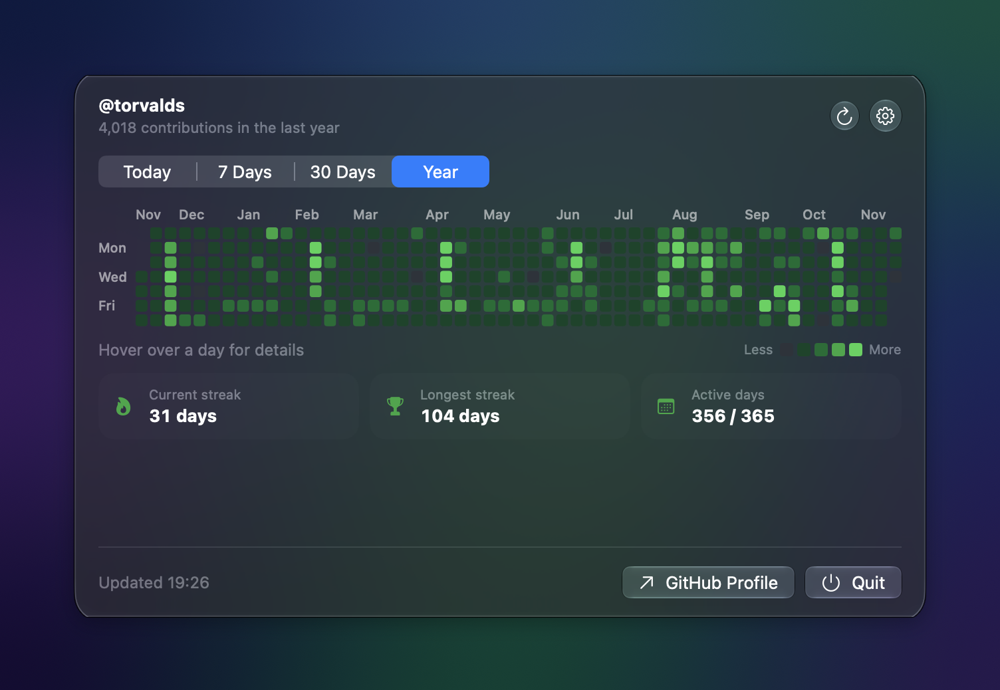
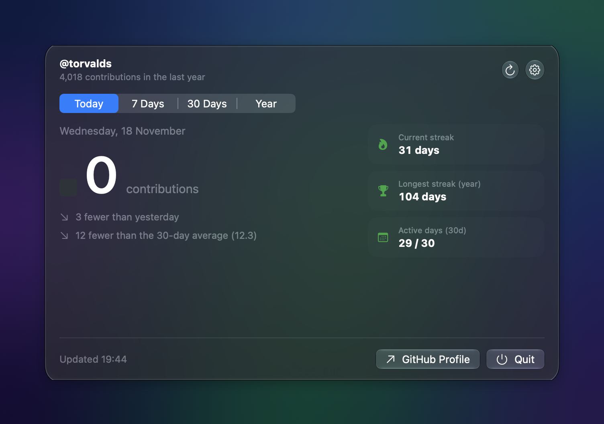
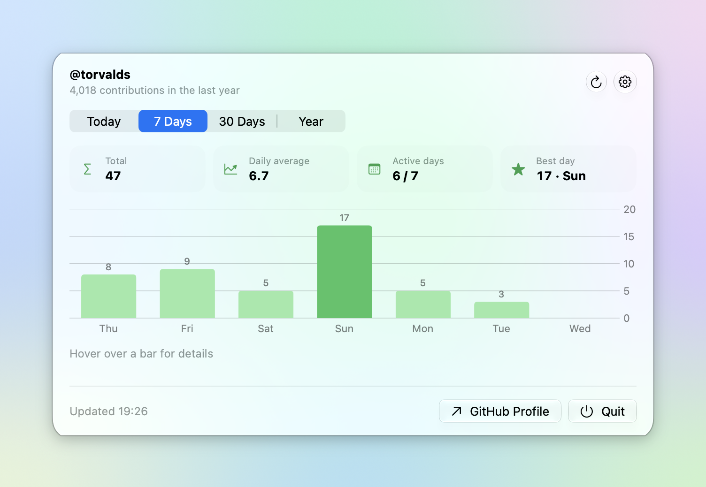
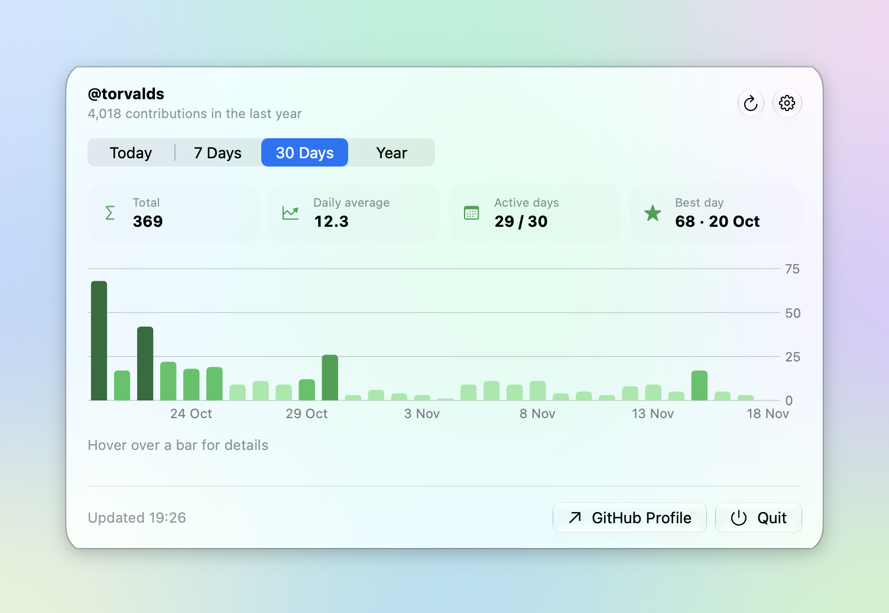
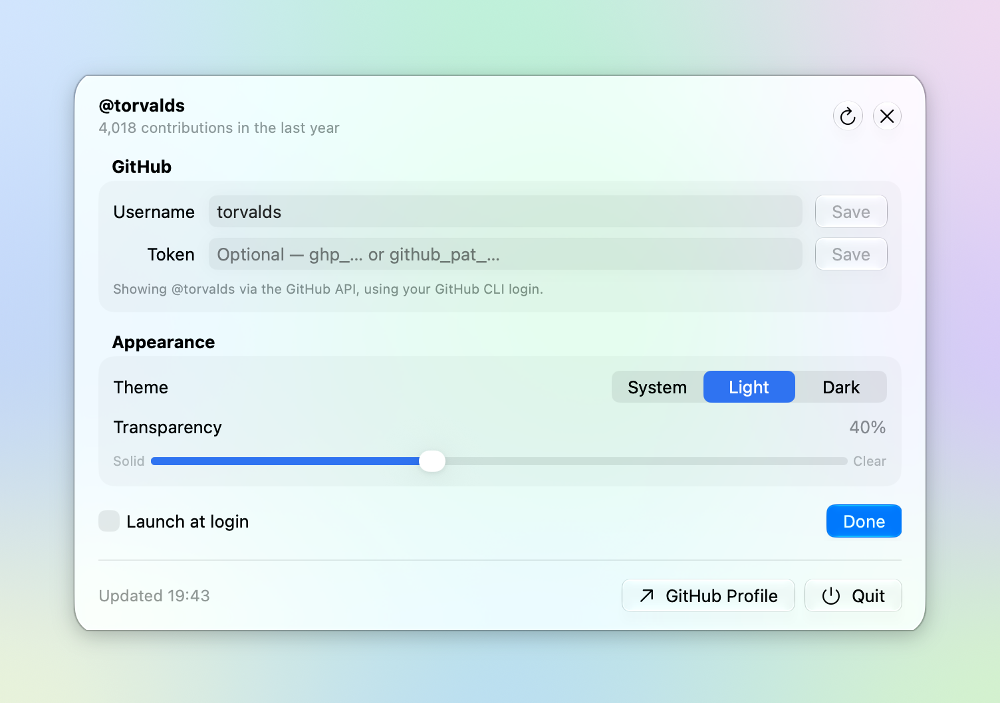

# ContribBar

Your GitHub contribution graph in the macOS menu bar.

<p align="center">
  
</p>

| Today | 7 Days |
|---|---|
|  |  |
| **30 Days** | **Settings** |
|  |  |

<sub>Screenshots show [@torvalds](https://github.com/torvalds)'s public contribution graph, loaded with the username option.</sub>

The menu bar shows today's count next to the last 7 days as little green squares. Click it for a Liquid Glass panel with four views:

| Tab | What you see |
|---|---|
| **Today** | Today's count, compared with yesterday and your 30-day average, plus current streak, longest streak and active days |
| **7 Days** | Bar chart with daily counts, total, average, active days and best day |
| **30 Days** | The same, over 30 days; hover over a bar for that day's details |
| **Year** | The familiar GitHub contribution grid; hover over any day for its count |

Other features:

- Works **without a token**: just enter a GitHub username.
- Uses your existing **GitHub CLI** login automatically if you have one.
- **Theme**: System, Light or Dark (Liquid Glass with GitHub's green palette), or a solid finish with engraved ink and its own level colors: **Cobalt** (anodized metal, fire-opal levels), **Fire Opal** (glowing gem, cobalt levels), **Emerald** (jewel-tone metal, marigold levels) or **Sand** (matte cream, terracotta levels). Finishes catch the light differently each time the panel opens.
- **Transparency** slider for the glass panel (Solid → Clear; glass themes only).
- Refreshes every 10 minutes, after your Mac wakes, and when you open the panel.
- Optional launch at login.

## Requirements

- **macOS 26 (Tahoe) or later**, which is needed for Liquid Glass.
- **Xcode 26 or later** (or its Command Line Tools) to build. No Xcode project is needed; it's a Swift package.

## Build and run

```sh
git clone https://github.com/graydeveloper01/contribbar.git
cd contribbar
./build.sh --open
```

`build.sh` compiles a release build, wraps it in `build/ContribBar.app` (a menu-bar-only app with no Dock icon), ad-hoc signs it, and with `--open` launches it. Look for the green squares in your menu bar.

To keep it, move the app into Applications:

```sh
mv build/ContribBar.app /Applications/
open /Applications/ContribBar.app
```

> ContribBar is distributed as source only. An app you build on your own Mac opens without any Gatekeeper warnings. A copy built elsewhere and downloaded isn't notarized, so macOS blocks it until it's approved under **System Settings → Privacy & Security → Open Anyway**.

### Development

```sh
swift build        # debug build
swift run          # run from the terminal (Ctrl-C to quit)
```

## Connecting your GitHub account

Pick whichever suits you. Everything is in the panel's **Settings** (gear icon).

### Option 1: Username only (no setup)

Open Settings, type your GitHub username and press **Save**. ContribBar reads the same public contribution graph shown on your GitHub profile. No token or login is needed.

Limitations of this mode:
- Private contributions are only counted if you've enabled **"Include private contributions on my profile"** in your GitHub profile settings.
- Day boundaries follow GitHub's public graph, which may not match your local timezone, so "today" can roll over at a different hour.
- It reads github.com's HTML rather than an official API, so a GitHub page change could break it until the app is updated.

### Option 2: GitHub CLI (automatic)

If you use the [GitHub CLI](https://cli.github.com) and are signed in (`gh auth login`), ContribBar picks up its token automatically via `gh auth token`, so there's nothing to configure. It looks for `gh` in `/opt/homebrew/bin`, `/usr/local/bin` and `/usr/bin`.

### Option 3: Personal access token

Create a [classic token](https://github.com/settings/tokens) with the `read:user` scope, paste it into Settings and press **Save**. It's stored in your macOS Keychain and takes priority over the GitHub CLI.

### Which source is used?

| Username set? | Token available (Keychain or `gh`)? | Result |
|---|---|---|
| No | Yes | Official API, the token's own account |
| Yes | Yes | Official API, that username's graph |
| Yes | No | Public profile graph |
| No | No | Prompts you to enter a username |

Settings always shows which source is active. The official API uses your local timezone for day boundaries.

If GitHub's API has trouble (server errors or query timeouts, which can happen with very active accounts), ContribBar retries twice. If it still fails, it shows the same account's public graph, marked "public graph" in the footer, and goes back to the API on the next refresh.

## Privacy

- ContribBar only talks to `api.github.com` (with a token) or `github.com` (without one).
- Tokens you paste are stored in the macOS Keychain. The GitHub CLI token is read on each refresh and never stored.
- There are no analytics and nothing else leaves your Mac.

## Project layout

```
Sources/ContribBar/
├── ContribBarApp.swift       App entry point
├── StatusController.swift    Menu bar item and the glass panel window
├── ContributionStore.swift   Refresh loop and choosing the data source
├── GitHubClient.swift        GraphQL API (token)
├── PublicContributions.swift Public profile graph (no token)
├── TokenStore.swift          Keychain and `gh auth token`
├── Models.swift              Days, streaks, stats
├── Palette.swift             GitHub greens, panel level colors, and the menu bar icon
├── Finish.swift              Solid finishes (Cobalt, Fire Opal, Emerald, Sand) and their plate renderer
├── PopoverView.swift         Panel layout, header, footer
├── TodayView.swift  RangeView.swift  YearView.swift  SettingsView.swift
build.sh                      Builds ContribBar.app
```

## Contributing

Issues and pull requests are welcome. Please run `swift build` with no warnings before opening a PR.

## License

[MIT](LICENSE)
